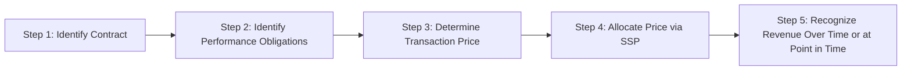

# 📊 Awesome Revenue Recognition & Revenue Operations (RevOps) 🚀

**A comprehensive, curated directory of leading Revenue Recognition (RevRec) engines, automated Revenue Subledgers, ASC 606 & IFRS 15 compliance platforms, and Revenue Operations (RevOps) automation tools — spanning enterprise SaaS solutions and open-source frameworks.**

[Explore SaaS Platforms](#-saas--hosted-platforms) • [Open-Source Solutions](#-open-source-software) • [Market Dynamics](#-sector-overview--market-dynamics) • [Feature Comparison](#-comparison-at-a-glance) • [Contributing](#-contributing)

---

## 📑 Table of Contents

- [🌐 Sector Overview & Market Dynamics](#-sector-overview--market-dynamics)
- [🏢 SaaS & Hosted Commercial Platforms](#-saas--hosted-platforms)
  - [Commercial Landscape Comparison Table](#-commercial-landscape-comparison)
  - [Detailed SaaS Profiles](#-detailed-saas-profiles)
- [💻 Open-Source Software & Toolkits](#-open-source-software)
  - [Open-Source Repository Directory (Ranked by Stars)](#-open-source-repository-directory)
  - [Detailed Open-Source Profiles](#-detailed-open-source-profiles)
- [⚖️ ASC 606 & IFRS 15 5-Step Compliance Checklist](#️-asc-606--ifrs-15-5-step-compliance-checklist)
- [📊 Comparison at a Glance](#-comparison-at-a-glance)
- [💖 Support](#-support)
- [⭐ Star History](#-star-history)
- [🤝 Contributing](#-contributing)
- [📄 License](#-license)

---

## 🌐 Sector Overview & Market Dynamics

The global **Revenue Recognition and Management Software** market is currently valued at approximately **$4.8 billion** and projected to surge past **$11.6 billion by 2031** (CAGR ~10.3%), alongside the broader **Revenue Operations (RevOps)** software sector expanding from **$4.5 billion toward $17.5+ billion** (CAGR ~16.8%). 

The revenue management and compliance sector remains **moderately fragmented**: high-end enterprise rev-rec is anchored by established giants and private-equity-backed incumbents like Zuora and Chargebee catering to intricate multi-element arrangements, while modern usage-based billing and AI-driven pipeline automation have fueled a dynamic wave of specialized, mid-market subledgers (Maxio, RightRev, Subscript, Leapfin) and open-source agentic frameworks.

---

## 🏢 SaaS / Hosted Platforms

Commercial, audit-ready cloud platforms designed to automate multi-element performance obligations, standalone selling price (SSP) allocations, contract modifications, and billing-to-ERP subledger synchronization.

### 📋 Commercial Landscape Comparison

*Companies are ranked in descending order by estimated enterprise valuation / scale.*

| Product | Company Valuation / Revenue Scale | Specific Starting Price | Free Tier / Trial Limits | Core Specialty & Primary Use Case |
| :--- | :--- | :--- | :--- | :--- |
| **[Chargebee RevRec](https://www.chargebee.com/products/revenue-recognition/)** 💳 | **$3.5B Valuation** (~$150M–$200M+ ARR) | **$599/month** (Performance Tier starting point; custom quote for enterprise RevRec add-on) | **No free trial for RevRec**; Developer sandbox available indefinitely for billing APIs & test gateways | Automated revenue subledger, ASC 606 & IFRS 15 compliance, and multi-source ERP journal posting for subscription/usage businesses. |
| **[Zuora Revenue](https://www.zuora.com/products/revenue-recognition-automation/)** 📈 | **$1.7B Valuation** (~$450M ARR, Acquired by Silver Lake / GIC) | **$75,000/year** (~$6,250/month entry-level enterprise contract via procurement benchmarks) | **No free tier or public trial** (Custom guided proof-of-concept for enterprise accounts) | Enterprise-grade touchless revenue automation engine (RevPro), complex multi-element contract carves, SSP reallocations, and multi-book accounting. |
| **[Maxio](https://www.maxio.com/)** 💼 | **$50M+ ARR** ($17B+ managed billing volume; backed by Summit Partners) | **$599/month** (~$7,188/year on the Grow plan for core subscription billing & reports) | **Build Plan (Free Sandbox)** with no expiration for testing APIs/dummy gateways; **No live free trial** for production RevRec | Purpose-built B2B SaaS revenue recognition with 25+ automated recognition rules, deferred revenue waterfall reports, and native GL integration. |
| **[RightRev](https://www.rightrev.com/)** ⚡ | **$30M+ Total Funding** (Growth Stage) | **$30,000/year** (~$2,500/month baseline contract based on Vendr/partner marketplace estimates) | **No free tier or public trial** (Requires a scoping consultation and dedicated proof-of-concept) | Salesforce-native revenue recognition subledger, event-triggered revenue milestones, automated contract modifications, and CPQ-to-GL audit trails. |
| **[Subscript](https://www.subscript.com/)** 📊 | **Early-to-Growth Stage** (Venture-Backed) | **$24,000/year** ($2,000/month median entry point for combined Billing + Analytics; range $15k–$150k/yr) | **No free tier or trial** (Guided custom architectural demo provided upon request) | Unified B2B SaaS billing engine and ASC 606 rev rec schedules replacing spreadsheet models, featuring 50+ out-of-the-box SaaS performance metrics. |
| **[Leapfin](https://www.leapfin.com/)** 🔄 | **Early-to-Growth Stage** (Backed by Menlo Ventures) | **$6,000/year** ($500/month starting baseline for Standard tier; scales to $1,000+/mo for Premium) | **No free tier or trial** (Requires private proof-of-concept and customized data architecture scoping) | Revenue accounting data platform and financial subledger unifying fragmented payment gateways, billing engines, and ERP reconciliation. |

---

### 🔍 Detailed SaaS Profiles

#### Zuora Revenue (RevPro) 📈
* **Category:** Enterprise Revenue Automation & Multi-Book Accounting
* **Overview:** Zuora Revenue (powered by the industry-standard RevPro engine) delivers touchless, automated revenue recognition compliant with ASC 606 and IFRS 15 across any recurring, usage, or hybrid business model. It handles advanced variable consideration, SSP allocation calculations, contract modifications with retrospective or prospective reallocation, and automated GL journal entry generation.
* **Target Audience:** Large enterprises handling complex, high-volume multi-element contracts requiring complete compliance auditability.

#### Chargebee RevRec 💳
* **Category:** Subscription Revenue Subledger & Multi-Currency Recognition
* **Overview:** Designed as an end-to-end revenue subledger, Chargebee RevRec ingests transactional data across CRM and billing endpoints (Salesforce, Stripe, HubSpot) to automatically generate monthly waterfalls, manage material rights, evaluate collectibility, and output ready-to-post journal entries to NetSuite, Sage Intacct, and QuickBooks.
* **Target Audience:** Fast-growing subscription and recurring-revenue businesses seeking native integration between billing workflows and audit-ready revenue schedules.

#### Maxio 💼
* **Category:** B2B SaaS Billing, Metrics & Revenue Recognition
* **Overview:** Formed by the merger of SaaSOptics and Chargify, Maxio automates revenue recognition specifically engineered around SaaS economics. It offers 25+ out-of-the-box recognition methods, performance obligation grouping, automated carveouts, and one-click cohort rollforwards (ARR, churn, DSO, A/R aging).
* **Target Audience:** B2B SaaS finance teams aiming to compress month-end close cycles from weeks to days while centralizing invoicing and metrics.

#### RightRev ⚡
* **Category:** Salesforce-Native Event-Based Revenue Subledger
* **Overview:** Built natively on the Salesforce platform, RightRev eliminates brittle ETL pipelines by executing revenue recognition directly against Salesforce CPQ, Billing, and Order records. It supports real-time event-triggered revenue releases (milestone sign-offs, consumption thresholds, delivery confirmations) and dynamic SSP calculations.
* **Target Audience:** Organizations heavily invested in Salesforce wanting real-time revenue visibility and contract modification recalculations within their CRM.

#### Subscript 📊
* **Category:** B2B Subscription Billing & Compliance Intelligence
* **Overview:** Subscript unifies complex subscription billing with automated ASC 606 / IFRS 15 rev rec schedules. Designed to eradicate fragile Excel models, it tracks seat-based, milestone, and multi-year custom arrangements while generating 50+ real-time SaaS health indicators (NRR, CARR, LTV, quick ratio).
* **Target Audience:** High-growth B2B SaaS finance leaders who require automated revenue waterfall schedules paired with deep analytics and Xero/NetSuite connectivity.

#### Leapfin 🔄
* **Category:** High-Volume Financial Subledger & Ledger Reconciliation
* **Overview:** Leapfin acts as an operational data platform that ingests millions of granular micro-transactions across PSPs, billing tools, and app stores, translating raw transaction logs into unified, auditable GAAP/IFRS revenue subledgers ready for ERP ingestion.
* **Target Audience:** Scale-ups and enterprises with high-volume, multi-channel transactional flows where billing and accounting data frequently diverge.

---

## 💻 Open-Source Software

Self-hosted frameworks, developer toolkits, desktop accounting utilities, and AI-native RevOps agent skills designed to support revenue compliance, contract risk audits, and go-to-market operational workflows.

### 🌟 Open-Source Repository Directory

*Repositories are sorted in descending order by GitHub stargazers count.*

| Repository | GitHub_Stars | Stack / Technology | Primary Focus & Capabilities |
| :--- | :---: | :--- | :--- |
| **[eigent-ai/eigent](https://github.com/eigent-ai/eigent)** 🤖 |  | Python / Agentic Platform | Open-source agentic cowork system automating CRM data hygiene, cross-team handoffs, and pipeline/revenue business intelligence reporting. |
| **[LeadMagic/gtm-skills](https://github.com/LeadMagic/gtm-skills)** 🎯 |  | Markdown / Agent Playbooks | Production-tested GTM and RevOps agent skills for Claude Code, Codex, and Copilot covering pipeline operations, outbound, and customer analytics. |
| **[NEON-Rutger/B2B-revops-skills](https://github.com/NEON-Rutger/B2B-revops-skills)** 🚀 |  | Markdown / Claude Skill Framework | Open-source revenue operations layer for LLM agents featuring 45+ B2B RevOps playbooks, pipeline architecture, and GTM execution guides. |
| **[ivangfalco/gtm-skills](https://github.com/ivangfalco/gtm-skills)** 📦 |  | Markdown / Strategy Framework | ColdIQ go-to-market and RevOps methodology repository containing 42+ structured modules across outbound prospecting, ABM, and revenue workflows. |
| **[tanin47/book-of-revenue](https://github.com/tanin47/book-of-revenue)** 📖 |  | Python / Documentation | In-depth engineering design, data schemas, and ledger patterns for building scalable billing, invoicing, and revenue recognition software engines. |
| **[ChipmunkRPA/eRev](https://github.com/ChipmunkRPA/eRev)** 🖥️ |  | Python / SQLite (Windows EFS) | Standalone desktop revenue recognition application providing complete local ASC 606 & IFRS 15 allocation schedules, data encryption, and BI connectivity. |
| **[elijeangilles/revops-skills](https://github.com/elijeangilles/revops-skills)** 🔍 |  | Shell / Agent Skills | Targeted Claude Agent skill pack engineered for Salesforce administrators and RevOps practitioners to audit CRM pipelines and automate fixes. |
| **[wongcpa/ifrs15-contract-reviewer](https://github.com/wongcpa/ifrs15-contract-reviewer)** 📝 |  | Python / CLI / WebApp | Automated contract scanner parsing text and PDF agreements against IFRS 15, ASC 606, and ASPE 3400 compliance risks and variable considerations. |
| **[fernandoxavier02/ifrs15-revenue-intelligence-showcase](https://github.com/fernandoxavier02/ifrs15-revenue-intelligence-showcase)** 🎓 |  | Python / FastAPI / PostgreSQL | Educational architectural reference implementation of the 5-step revenue recognition standard featuring FastAPI endpoints and synthetic fixtures. |

---

### 🔍 Detailed Open-Source Profiles

#### [eigent-ai/eigent](https://github.com/eigent-ai/eigent) 🤖
* **License:** Open Source (Self-Hostable)
* **Overview:** An open-source agentic work platform built for Revenue Operations teams. Eigent unifies front-line CRM hygiene, automated lead/opportunity qualification handoffs, sales stage validation, and weekly executive pipeline reporting across Salesforce, HubSpot, and Pipedrive.

#### [NEON-Rutger/B2B-revops-skills](https://github.com/NEON-Rutger/B2B-revops-skills) 🚀
* **License:** MIT
* **Overview:** A specialized revenue operations skill layer built for AI assistants (like Claude). Houses 45+ comprehensive playbooks covering funnel architecture, customer acquisition cost (CAC) calculations, retention cohort analysis, deal velocity tracking, and CRM process automation.

#### [ChipmunkRPA/eRev](https://github.com/ChipmunkRPA/eRev) 🖥️
* **License:** Free Tier (Core Compliance Functions) / Commercial Premium
* **Overview:** A pure Python, desktop-oriented application designed for corporate accountants needing ASC 606 / IFRS 15 calculation schedules without transmitting sensitive financial records to external cloud servers. Encrypted via Windows EFS with direct SQLite export capability to PowerBI and Tableau.

#### [wongcpa/ifrs15-contract-reviewer](https://github.com/wongcpa/ifrs15-contract-reviewer) 📝
* **License:** MIT
* **Overview:** An accounting audit utility written in Python that scans PDF contracts and service agreements for IFRS 15 / ASC 606 trigger events — including variable consideration caps, bundled performance obligations, right-of-return clauses, and material financing components.

#### [fernandoxavier02/ifrs15-revenue-intelligence-showcase](https://github.com/fernandoxavier02/ifrs15-revenue-intelligence-showcase) 🎓
* **License:** MIT
* **Overview:** An open-source reference architecture and educational prototype modeling the canonical five-step rev-rec waterfall. Powered by FastAPI and PostgreSQL, it demonstrates programmatic performance obligation breakdown, SSP calculation algorithms (residual, adjusted market, expected cost plus margin), and journal entry readiness.

---

## ⚖️ ASC 606 & IFRS 15 5-Step Compliance Checklist

The cornerstone framework underpinning all revenue recognition software:

1. **Step 1: Identify the Contract with a Customer** — Verify commercial substance, approval, payment terms, and collectibility thresholds.
2. **Step 2: Identify the Performance Obligations (POBs)** — Unbundle distinct goods or services from complex master agreements.
3. **Step 3: Determine the Transaction Price** — Calculate fixed fees, discounts, rebates, penalties, and variable consideration estimates.
4. **Step 4: Allocate Transaction Price** — Apportion contract revenue based on relative Standalone Selling Price (SSP) calculations.
5. **Step 5: Recognize Revenue** — Release revenue to the general ledger either point-in-time (upon delivery) or over time (ratable subscription period).

---

## 📊 Comparison at a Glance

| Software Solution | Type & Deployment | Primary Standard | RevOps Pipeline Support | Self-Hosted Option | Best Suited For |
| :--- | :--- | :--- | :---: | :---: | :--- |
| **Zuora Revenue** | Commercial Cloud | ASC 606 / IFRS 15 | ⚠️ (ERP focus) | ❌ | High-volume enterprise multi-element contracts |
| **Chargebee RevRec** | Commercial Cloud | ASC 606 / IFRS 15 | ⚠️ (Billing sync) | ❌ | Recurring subscription billing & multi-book ERP posting |
| **Maxio** | Commercial Cloud | ASC 606 / IFRS 15 | ⚠️ (SaaS metrics) | ❌ | B2B SaaS finance teams needing billing + rev rec sync |
| **RightRev** | Salesforce-Native | ASC 606 / IFRS 15 | ✅ | ❌ | Salesforce CPQ and Billing-centric architectures |
| **Subscript** | Commercial Cloud | ASC 606 / IFRS 15 | ✅ | ❌ | Fast-growing SaaS companies replacing spreadsheet models |
| **Leapfin** | Commercial Cloud | ASC 606 / IFRS 15 | ⚠️ (Data lake) | ❌ | Large transactional datasets needing billing-to-ERP reconciliation |
| **eigent** | Open Source | RevOps Automation | ✅ | ✅ | AI-driven CRM hygiene, reporting, and team handoffs |
| **B2B-revops-skills** | Open Source | RevOps Playbooks | ✅ | ✅ | LLM agent playbooks for B2B SaaS revenue operations |
| **eRev** | Desktop App | ASC 606 / IFRS 15 | ❌ | ✅ | Privacy-first local accounting and SSP allocations |
| **ifrs15-reviewer** | Open Source | ASC 606 / IFRS 15 | ❌ | ✅ | Automated contract audit & compliance risk scanning |

---

## 💖 Support

Thank you for exploring and utilizing this curated directory! If this resource has helped streamline your revenue recognition research, ASC 606 / IFRS 15 compliance checks, or RevOps architecture:

- ⭐ **Star this repository** to show your appreciation and help other finance professionals discover it.
- 🍴 **Fork the repo** to benchmark and extend tools for your team.
- 📢 **Share it** on LinkedIn, Twitter/X, Discord, or with your finance and engineering colleagues.
- ☕ **Support the maintainer**: If you'd like to support ongoing curation and open-source contributions, you can buy a coffee via the [GitHub Sponsors Dashboard](https://github.com/sponsors/ishandutta2007).

---

##  Star History

---

## 🤝 Contributing

Contributions are welcomed and encouraged! 

Whether you've developed an open-source accounting engine, an AI RevOps workflow, or want to update vendor specifications:

1. 🍴 Fork the repository.
2. 🌿 Create a descriptive branch (`git checkout -b feature/add-new-tool`).
3. 📝 Add your tool with verified pricing, GitHub Stars_Badges, and technical specs.
4. 🚀 Submit a Pull Request.

---

## 📄 License

This collection is curated under the [Creative Commons Zero v1.0 Universal (CC0-1.0)](LICENSE) Public Domain Dedication. Individual software tools and repositories maintain their respective licenses.

---

⭐ **If you find this repository valuable for your finance and RevOps operations, please consider giving it a star!** ⭐

